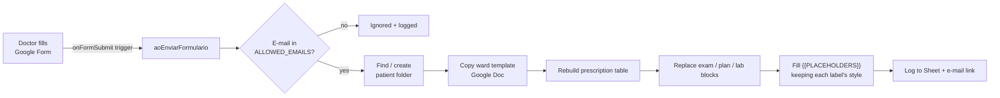

# 🏥 Apps Script Medical Record

**Fill in one Google Form → get a print-ready hospital medical record in the patient's Drive folder.**

Doctors at a small hospital in Brazil kept their records as Word templates in Google Drive. Every admission went the same way: copy the ward template, create the patient folder, move the copy into it, then retype the header, the prescription table, the progress note and the lab request by hand.

This project replaces that with a **Google Form + Google Apps Script**. The doctor answers a short form (on a phone or a PC), and a few seconds later a document appears in the right folder. It looks exactly like the hospital's own template: same tables, fonts, bold labels, logo and signature lines.

> The code (identifiers, comments, form text) is in **Portuguese**, because the users are Brazilian doctors. This README explains it in English.

---

## ✨ Features

| | |
|---|---|
| 📝 **One form, every ward** | Male, Female, Psychiatry, Pediatrics, Postpartum (mother **and** newborn), plus both ER wards. The first answer sends the doctor to that ward's prescription section. |
| 💊 **Smart prescription** | The ward's standard orders are pre-loaded. The doctor can **remove** items, **change the diet** and **add** new medications, one per line. The table is renumbered `01, 02, 03…` with no gaps. If it runs out of rows, the extra items go to a "continuation" list instead of being lost. |
| 🎨 **Keeps the hospital's formatting** | Only the *values* are written into the template, never the labels. Fonts (Archivo Black, Kanit), sizes, bold and spacing stay as in the original Word file. This was checked by comparing the `.docx` XML of a generated record with a real one. |
| 📂 **Finds or creates the patient folder** | Folder names are matched ignoring case, accents and extra spaces (`" Maria  Silva"` matches `MARIA SILVA`). |
| 🛡️ **Never deletes anything** | The script only *creates* files and folders. It never trashes, renames or overwrites. If a file name already exists, the new one gets ` (2)`. The original `.docx` templates are only read. |
| 🔐 **Access control** | The form collects verified Google e-mails, and only addresses in `ALLOWED_EMAILS` can generate documents. |
| 🧪 **Test mode** | With `MODO_TESTE = true`, everything goes to a `_TESTES DO FORMULÁRIO` folder, so it can be tried safely with real templates. |
| 📬 **Feedback** | Each run adds a row to a log sheet, and the doctor gets an e-mail with the document link (plus any warnings). |
| ✅ **Unit-tested core** | The text and prescription rules are plain JavaScript with no Google APIs, so they are tested with Node's built-in test runner. |

---

## ⚙️ How it works



### 1. One-time template preparation (`Setup.gs`)

`criarModelosDoFormulario()` converts a **copy** of each Word template to Google Docs and places `{{PLACEHOLDERS}}` in it. The real templates are messy:
- labels differ between wards (`IDAde`, `-NOME:`, `NOME DO PACIENTE:`);
- several labels share one line (`DATA DE ADMISSÃO: … HIPÓTESE DIAGNÓSTICA: … DIAS DE INTERNAÇÃO: 0`);
- one template still contained a previous patient's data.

So the marking step is rule-based (`Regras.gs`) and returns *edits* (`{start, end, text}`) instead of rewritten lines. Each edit replaces only the sample value after a label. The label keeps its original font, size and bold.

The step also:
- renumbers the prescription rows;
- finds the merged "patient name" cell (in Apps Script, merged cells show up as hidden `colSpan = 0` cells);
- replaces the Wingdings "as needed" arrow, which becomes 🆘 when converted to Google Docs, with `➔`.

A report lists what was found in each template, so a human can check it once.

### 2. Building the form (`Setup.gs`)

`criarFormulario()` builds the Google Form in code:
- a ward dropdown with page navigation;
- one prescription section per ward, with the "items NOT to use today" checkboxes **read from the template itself**;
- the identification, clinical and postpartum-discharge sections.

It also creates the responses spreadsheet and installs the trigger.

### 3. Every submission (`Preencher.gs`)

```
standard items − removed items, diet swapped, + additional items  →  01, 02, 03, …
```

`montarPrescricao()` builds the final list. The table cells are then filled by **copying the original cell content**, so per-word bold (`EV`, `SC`, `SOS`…) and the insulin sliding scale layout survive. Free-text blocks (physical exam, plan, lab request) replace the template text only when the doctor typed something. Otherwise the ward's default text stays.

---

## 📁 Project structure

```
src/
├── appsscript.json   # manifest: V8, Drive advanced service (v3), OAuth scopes
├── Config.gs         # folder/template IDs, wards, allowed e-mails, flags
├── Regras.gs         # pure rules (no Google APIs): placeholders, prescription, dates
├── Documento.gs      # Google Docs helpers: style-preserving edits, tables, blocks
├── Setup.gs          # one-time: create templates, build the form, refresh choices
└── Preencher.gs      # form-submit trigger: folder, copy, fill, log, e-mail
tests/
└── regras.test.js    # node:test suite for Regras.gs (loaded with node:vm)
```

---

## 🚀 Setup

### Option A: with [clasp](https://github.com/google/clasp)

```bash
npm install -g @google/clasp
clasp login
clasp create --type standalone --title "Medical Record Form" --rootDir src
clasp push
```

(Or copy `.clasp.json.example` to `.clasp.json` and fill in the `scriptId` of an existing project.)

### Option B: by hand

Create a project at [script.google.com](https://script.google.com) and turn on *"Show appsscript.json"* in the project settings. Then paste in each file from `src/`.

### Then

1. Fill in `src/Config.gs`:
   - the root folder ID;
   - each ward's folder ID and template `.docx` ID;
   - `ALLOWED_EMAILS`.

   Keep `MODO_TESTE: true` for now.
2. Run **`criarModelosDoFormulario`** and authorize the scopes.
3. Open the generated report and review the `{{PLACEHOLDERS}}` in each template.
4. Run **`criarFormulario`**. The log prints the form link for the doctors.
5. Send a test submission. When the result looks right, set `MODO_TESTE: false`.

If a template's standard prescription changes, edit the template Google Doc and run **`atualizarFormulario`**. The form checkboxes are rebuilt from it.

---

## 🧪 Tests

```bash
npm test
```

The rules in `Regras.gs` are plain functions, so the suite runs them in a `node:vm` context with no Google mocks. It covers:
- placeholder edits for every label variation in the real templates;
- that labels are never rewritten;
- the internment-box labels that share one line;
- diet swap / removal / additions, with the numbering left gap-free;
- name normalization and date helpers.

---

## 🔒 Privacy

This repository holds **only code**: no patient data, no real Drive IDs, no e-mails. All IDs in `Config.gs` are placeholders. The test fixtures use made-up names.

The generated records stay in the hospital's own Google Drive. The script needs no external services.

---

## 🛠️ Tech

Google Apps Script (V8) · FormApp · DocumentApp · DriveApp + Drive API v3 (DOCX → Google Docs conversion) · SpreadsheetApp · MailApp · LockService · Node.js `node:test`
