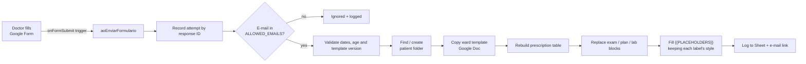

# 🏥 Apps Script Medical Record

**Fill in one Google Form → get a hospital record for medical review and signature in the patient's Drive folder.**

Doctors at a small hospital in Brazil kept their records as Word templates in Google Drive. Every admission went the same way: copy the ward template, create the patient folder, move the copy into it, then retype the header, the prescription table, the progress note and the lab request by hand.

This project replaces that with a **Google Form + Google Apps Script**. The doctor answers a form and the document appears in the patient's folder. It uses the hospital's layout with clinical content supplied for the current encounter. Empty clinical fields show a missing-record notice; no examination, plan or medication is assumed.

> The code (identifiers, comments, form text) is in **Portuguese**, because the users are Brazilian doctors. This README explains it in English.

---

## ✨ Features

| | |
|---|---|
| 📝 **One form, every ward** | Male, Female, Psychiatry, Pediatrics, Postpartum (mother **and** newborn), plus both ER wards. The first answer sends the doctor to that ward's prescription section. |
| 💊 **Prescription per encounter** | Starts empty. The doctor selects the items to include from a medically reviewed list and can type additional items. Only selected items, explicit diet and additions are transferred. Pediatric/newborn entries require age, positive weight and indication. The script does not calculate or validate clinical doses. |
| 🎨 **Keeps the hospital's formatting** | Only the *values* are written into the template, never the labels. Fonts (Archivo Black, Kanit), sizes, bold and spacing stay as in the original Word file. This was checked by comparing the `.docx` XML of a generated record with a real one. |
| 📂 **Finds or creates the patient folder** | Folder names are matched ignoring case, accents and extra spaces (`" Maria  Silva"` matches `MARIA SILVA`). |
| 🛡️ **Never deletes anything** | The script only *creates* files and folders. It never trashes, renames or overwrites. If a file name already exists, the new one gets ` (2)`. The original `.docx` templates are only read. |
| 🔐 **Access control** | The form collects verified Google e-mails, and only addresses in `ALLOWED_EMAILS` can generate documents. |
| 🧪 **Test mode** | With `MODO_TESTE = true`, everything goes to a `_TESTES DO FORMULÁRIO` folder, so it can be tried safely with real templates. |
| 📬 **Traceability** | The `Processamento` sheet records attempts, ignored responses, errors, partial file IDs and success by response ID. `Documentos gerados` lists completed records. Email/export failures have their own states. |
| 🔎 **Reconciliation** | `conciliarDocumentos()` creates a separate report of responses, logs and files found in ward/test folders. A count difference alone is never classified as lost responses. |
| ✅ **Data validation** | Invalid dates, admission before birth, future dates, incompatible ages and nonpositive weights block generation. |
| ✅ **Unit-tested core** | The text and prescription rules are plain JavaScript with no Google APIs, so they are tested with Node's built-in test runner. |

---

## ⚙️ How it works



### 1. One-time template preparation (`Setup.gs`)

`criarModelosDoFormulario()` converts a **copy** of each Word template to Google Docs and places `{{PLACEHOLDERS}}` in it. The real templates are messy:
- labels differ between wards (`IDAde`, `-NOME:`, `NOME DO PACIENTE:`);
- several labels share one line (`DATA DE ADMISSÃO: … HIPÓTESE DIAGNÓSTICA: … DIAS DE INTERNAÇÃO: 0`);
- one template still contained a previous patient's data.

So the marking step is rule-based (`Regras.gs`) and returns *edits* (`{start, end, text}`) instead of rewritten lines. Each edit replaces only the sample value after a label. The label keeps its original font, size and bold.

The step also:
- renumbers and empties the prescription rows;
- finds the merged "patient name" cell (in Apps Script, merged cells show up as hidden `colSpan = 0` cells);
- replaces recognized clinical blocks with markers and neutralizes known obstetric labels.

A report lists what was found in each template, so a human can check it once.

### 2. Building the form (`Setup.gs`)

`criarFormulario()` builds the Google Form in code:
- a ward dropdown with page navigation;
- one prescription section per ward with multiple selection of items to include, initially empty;
- the identification, clinical and postpartum-discharge sections.

It also creates the responses spreadsheet and installs the trigger.

### 3. Every submission (`Preencher.gs`)

```
explicit diet + explicitly selected reviewed options + additional items → 01, 02, 03, …
```

`montarPrescricaoSelecionada()` accepts only explicitly selected options from `CONFIG.OPCOES_PRESCRICAO` with `revisado: true`, or exact allowlisted documentation reminders with `tipo: 'registro'`. The initial catalog contains reminders only, with no drugs or doses. Empty selection adds nothing. Unknown or changed options block generation. Template orders and legacy removal choices are ignored. Clinical blocks are replaced even when empty, including blocks inside table cells. Missing fields use labeled content appended to the document. Known obstetric labels are cleared during preparation, and older template versions are blocked until recreated.

Postpartum discharge prescriptions are created as a new plain document with only the entered items, identity, date and signature line. The old fixed prescription is not copied.

---

## 📁 Project structure

```
src/
├── appsscript.json   # manifest: V8, Drive advanced service (v3), OAuth scopes
├── Config.gs         # folder/template IDs, wards, allowed e-mails, flags
├── Regras.gs         # pure rules (no Google APIs): placeholders, prescription, dates
├── Documento.gs      # Google Docs helpers: style-preserving edits, tables, blocks
├── Setup.gs          # one-time: create templates, build the form, refresh choices
├── Preencher.gs      # form-submit trigger: folder, copy, fill, log, e-mail
└── Rastreio.gs       # response/file audit and reconciliation report
tests/
└── regras.test.js    # node:test suite for Regras.gs (loaded with node:vm)
```

---

## 🚀 Setup

### Option A: with [clasp](https://github.com/google/clasp)

```bash
npm install -g @google/clasp
clasp login
clasp create --type standalone --title "Medical Record Form" --rootDir src
clasp push
```

(Or copy `.clasp.json.example` to `.clasp.json` and fill in the `scriptId` of an existing project.)

### Option B: by hand

Create a project at [script.google.com](https://script.google.com) and turn on *"Show appsscript.json"* in the project settings. Then paste in each file from `src/`.

### Then

1. Fill in `src/Config.gs`:
   - the root folder ID;
   - each ward's folder ID and template `.docx` ID;
   - `ALLOWED_EMAILS`.

   Keep `MODO_TESTE: true` for now.
2. Run **`criarModelosDoFormulario`** and authorize the scopes.
3. Open the generated report and review the `{{PLACEHOLDERS}}` in each template.
4. Run **`criarFormulario`**. The log prints the form link for the doctors.
5. Send a test submission. When the result looks right, set `MODO_TESTE: false`.

For an existing installation, follow [the migration and verification guide (Portuguese)](docs/atualizacao-segura.md). Preserve the live IDs and emails in `Config.gs`; the repository contains placeholders. Fill the reviewed options in `OPCOES_PRESCRICAO` and run `atualizarFormulario()`. It preserves historical questions and answers, moves obsolete removal questions to an unreachable legacy section and adds inclusion questions with distinct IDs. Historical exclusions can never become current inclusions.

---

## 🧪 Tests

```bash
npm test
```

The rules in `Regras.gs` are plain functions tested in a `node:vm` context. Document, processing and migration tests use small Google API doubles. Coverage includes:
- placeholder edits for every label variation in the real templates;
- that labels are never rewritten;
- the internment-box labels that share one line;
- empty-by-default prescriptions and explicit additions;
- clinical replacement in tables, missing-field fallbacks and obstetric cleanup;
- date, age, weight and pediatric/newborn prerequisites;
- response/file audit, error paths and conservative reconciliation;
- repeatable form migration preserving question IDs.

Tests use small doubles for the public Google APIs. They do not establish that the live project is updated or that the real templates render correctly. Verify the generated documents in test mode and obtain medical review before clinical use.

---

## 🔒 Privacy

This repository holds **only code**: no patient data, no real Drive IDs, no e-mails. All IDs in `Config.gs` are placeholders. The test fixtures use made-up names.

The generated records stay in the hospital's own Google Drive. The script needs no external services.

---

## 🛠️ Tech

Google Apps Script (V8) · FormApp · DocumentApp · DriveApp + Drive API v3 (DOCX → Google Docs conversion) · SpreadsheetApp · MailApp · LockService · Node.js `node:test`
